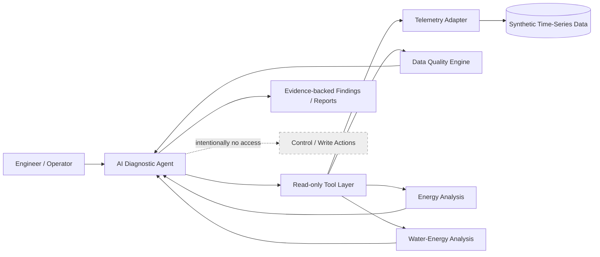

# Industrial AI Diagnostic Agent

**Agentic AI for industrial telemetry diagnostics, historical cycle analysis, and energy reasoning — with control actions intentionally kept outside the AI boundary.**

[](https://www.python.org/)
[](tests/)
[](docs/safety.md)

> **Portfolio-safe public implementation.** This repository uses synthetic telemetry and generic adapters. It intentionally contains no production endpoints, credentials, machine names, internal network details, proprietary tag maps, or organization-specific infrastructure.

## Why this project is interesting

Industrial failures rarely live in one signal. A useful diagnostic agent has to correlate **time-series telemetry, sequence state, data quality, equipment behavior, and deterministic engineering calculations** without confusing missing data with a physical zero or allowing an LLM to make control decisions.

This project demonstrates that architecture in a safe public form.

### Technical highlights

- **Agentic tool use** — an AI layer can select read-only tools and gather evidence across multiple diagnostic rounds.
- **Deterministic engineering math** — energy integration and water-energy calculations live in Python, not in free-form LLM arithmetic.
- **Time-series reasoning** — cycle boundaries, coverage, gaps, counter resets, and timestamp-aware integration.
- **Evidence-aware diagnostics** — separates observed evidence, inference, unknowns, and blocked calculations.
- **Safety by design** — the public tool surface exposes observation and analysis only; no control/write functions exist.
- **Context-efficient analysis** — tools summarize large telemetry windows before returning evidence to the agent.
- **Reusable interaction** — supports large multiline requests (`/paste`) and local text context (`/files`).

## Architecture



## Example investigation

A synthetic equipment cycle contains cumulative energy counters and sampled power. The agent/tool layer can:

1. identify the requested time window;
2. check whether the measurements have usable coverage;
3. detect counter resets or suspicious gaps;
4. calculate energy from the cumulative counter;
5. independently integrate timestamped power;
6. compare both estimates instead of silently averaging disagreements;
7. return compact evidence for higher-level reasoning.

Example result shape:

```text
Equipment A
  Counter energy       : 12.48 kWh
  Integrated power     : 12.41 kWh
  Difference           : -0.56%
  Counter reset        : false
  Coverage assessment  : usable

Conclusion
  Independent measurements agree closely enough to support the
  reported electrical-energy result for this synthetic cycle.
```

See [`examples/demo_result.md`](examples/demo_result.md) for a fuller walkthrough.

## Engineering analysis principles

The implementation intentionally avoids several common analysis mistakes:

- missing measurements are **not replaced with zero**;
- a numeric sample is not automatically treated as verified-good quality;
- cumulative energy and integrated power are compared independently;
- integration uses actual timestamps rather than assuming perfect sampling;
- water-energy calculations require explicit level/temperature mappings;
- unsupported efficiency/COP calculations are marked **blocked**, not invented;
- overlapping measurements should not be double-counted as independent energy inputs.

## Repository structure

```text
industrial-ai-agent/
├── agent/       Interactive agent shell
├── mcp/         Read-only MCP-style tool facade
├── adapters/    Synthetic telemetry adapter
├── analysis/    Deterministic engineering calculations
├── examples/    Sample telemetry, mappings, prompt, and demo result
├── docs/        Architecture, safety, quality, and recruiter overview
├── tests/       Calculation tests
└── .github/     CI workflow
```

## Quick start

```bash
python -m venv .venv
```

Windows PowerShell:

```powershell
.\.venv\Scripts\Activate.ps1
pip install -r requirements.txt
pytest -q
python agent\industrial_agent.py
```

Then try a large request:

```text
You: /paste
Analyze the most recent completed sample cycle. Validate measurement
coverage, calculate supported electrical energy, compare the counter
against integrated power, and clearly identify unsupported metrics.
/end
```

The public demo does **not** require access to a real control system.

## Core calculation examples

Electrical energy from a cumulative meter:

```text
E_counter = counter(end) - counter(start)
```

Electrical energy from sampled power:

```text
E_power = integral(P(t) dt)
```

The implementation performs timestamp-aware numerical integration and reports disagreement between the two independent measurement bases.

For water inventory analysis, calculations are kept deterministic and mapping-driven rather than inferred by the language model. See [`analysis/water_energy.py`](analysis/water_energy.py).

## Safety by design

The tool boundary does not expose operations to:

- write control values;
- start or stop equipment;
- acknowledge alarms;
- change recipes or setpoints;
- alter configuration;
- modify historical records.

This is an architectural choice, not merely a prompt instruction. See [`docs/safety.md`](docs/safety.md).

## What this demonstrates

This project is relevant to **Robotics Software, Physical AI, Agentic AI, Industrial AI, Autonomous Systems, and ML/AI Engineering** because it combines:

`LLM tool use` · `MCP-style interfaces` · `time-series analytics` · `state/cycle reasoning` · `sensor-quality reasoning` · `deterministic Python` · `safety constraints` · `engineering validation`

## Testing

```bash
pytest -q
```

Tests cover the deterministic calculation layer so engineering math can be validated independently of the AI runtime.

## Design documentation

- [Architecture](docs/architecture.md)
- [Safety model](docs/safety.md)
- [Data-quality philosophy](docs/data_quality.md)
- [Recruiter / reviewer overview](docs/project_overview.md)

## Future work

- richer synthetic fault scenarios and benchmark cases;
- interactive trend visualization;
- pluggable local/cloud LLM runtimes;
- automated task-completion ledger for long investigations;
- expanded uncertainty propagation and unit metadata;
- CI checks for formatting, typing, and security scanning.

## Disclaimer

This is a portfolio/reference implementation, not a certified process-control, safety, or metering system. Validate mappings, units, calibration, quality semantics, and thermophysical assumptions before using calculations for engineering decisions.
